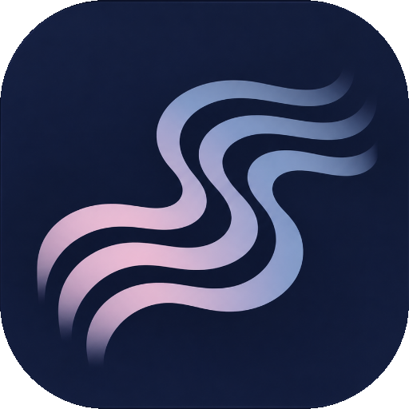
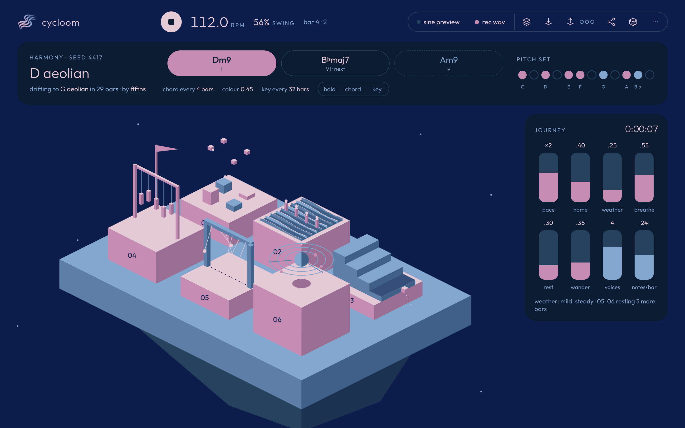
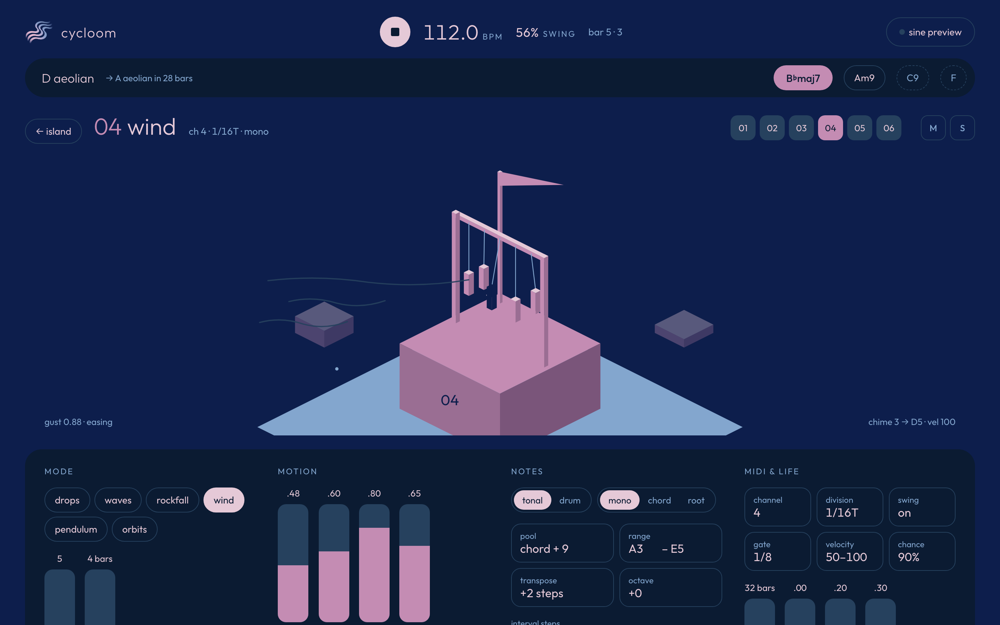
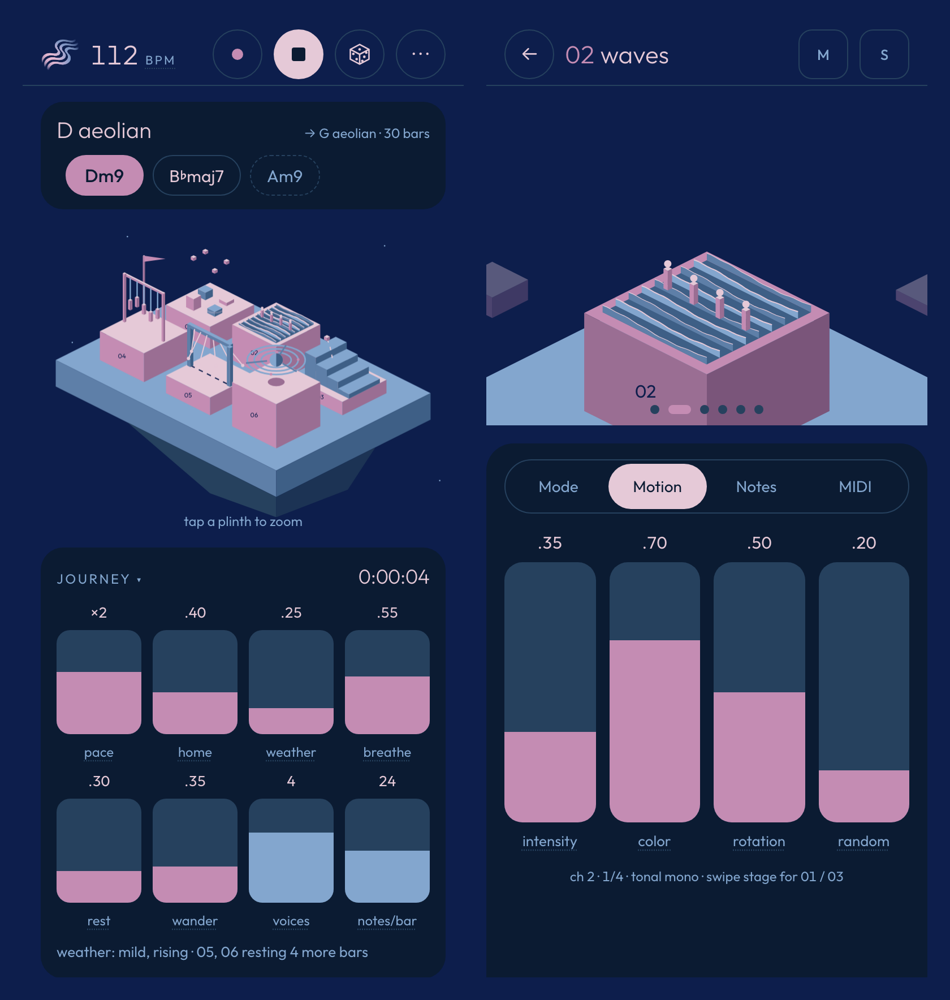
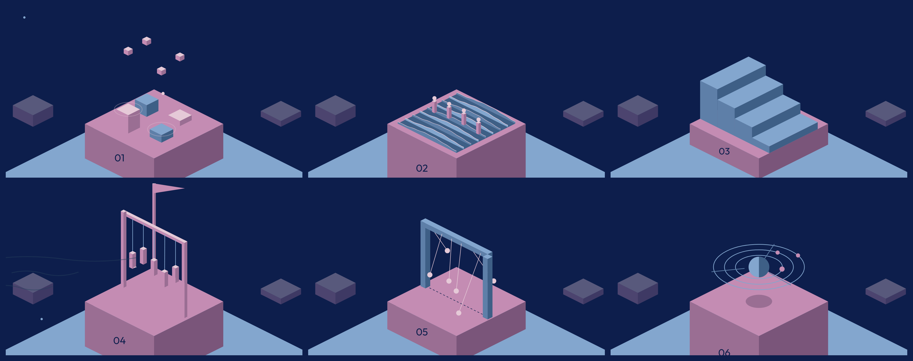

<p align="center"></p>

# Cycloom

**A generative sequencer that turns little physics worlds into music.** A floating isometric island holds one plinth per track. On each plinth something moves — water drops, waves, falling rocks, wind through chimes, pendulums, orbits — and every collision plays a note from a slowly evolving harmony. It drives any MIDI device — a multitimbral synth, a groovebox, a drum machine, a DAW — or plays on its own through a built-in sine preview. It is designed to run for hours as an ambient machine.



## Features

- **Six physics voices.** Drops (sparse, pointillist), waves (long notes), rockfall (bursts that speed up), wind (stepwise runs), pendulum (phasing patterns) and orbits (polyrhythms). Every collision lands exactly on the track's swung grid, so the animation and the rhythm are the same thing.
- **Living harmony.** Chords follow functional movement with voice leading, recolour themselves (sus, 7ths, extensions) and drift through related keys. Click any past chord to go back; the future branches anew.
- **Built for long runs.** Journey controls — pace, weather, breathing, rests, wander, a voice budget and a density cap — keep a patch changing for hours without looping.
- **Drones and swells.** Gates up to four bars, and a per-track swell that fades velocity in and out on co-prime cycles, Eno-style.
- **Presets and randomise.** Airports (tape-loop ambient), drone, shoreline and rain garden, or roll the die for a fresh set of drum and melodic voices.
- **Per-track control.** Tonal or drum, mono / chord / root voicing, pitch pool, range, interval steps, transpose, division, gate, velocity, chance — and a track can *listen* to another.
- **Record.** Saves the notes as a `.mid` file, or — with no MIDI device — the audio as a `.wav`.
- **Snap, scenes and share.** Quick snapshots to jump back to, named scenes, JSON files, and a compact link containing the tracks, harmony settings, journey and tempo.
- **Hardware-friendly.** Internal or external MIDI clock, MIDI learn with soft takeover, and a setup wizard for the Music Thing 8mu.
- **Everywhere.** Desktop, tablet and phone layouts; every control explains itself on hover, or with a tap on its label on touch screens.

<table>
<tr>
<td width="62%"></td>
<td></td>
</tr>
<tr>
<td colspan="2"></td>
</tr>
</table>

Design notes: [DESIGN.md](DESIGN.md).

## Run

```sh
npm ci
npm run dev        # http://localhost:5173
npm run build      # static site in dist/ (serve over HTTPS for Web MIDI)
```

- **Desktop:** Chrome or Edge (Web MIDI). Connect a MIDI device over USB; the first hardware port is picked automatically, or choose one in the top bar.
- **Android:** Chrome with a USB-OTG cable.
- **iOS:** open it in a Web MIDI browser app. The app detects the injected API and sends just-in-time, because those apps may ignore send timestamps. You can override this under ⋯ → timing.
- **No device:** notes play through a built-in sine preview. On iOS 17 and later it plays even with the silent switch on; on older iOS, turn the ringer on to hear it.

## Use

| | |
|---|---|
| Space | play / stop |
| click a plinth or track card | zoom into that track |
| Esc | back to the island |
| 1–9 | jump to a track |
| M / S | mute / solo the zoomed track |
| L | MIDI learn: tap a fader, then move a hardware control. Shift-tap binds to that track instead of "whichever track is zoomed" |
| R | randomise the tracks |
| ⌘Z / Ctrl-Z | undo |

Faders drag up and down relative to where they are (they don't jump to your finger). Double-click or double-tap resets a fader. Shift-drag gives fine control. Hover any control for a short explanation; on touch screens, tap its label (or long-press an icon).

**Top bar:** output port, rec (a `.mid` file with a MIDI device, a `.wav` of the sine preview without one), then icons: presets, snap (save a quick snapshot in this browser), restore (bring back the latest snapshot at the next bar while playing, or immediately while stopped; click a dot for an older one, long-press to keep it as a scene), share (copy a link containing the musical setup), randomise (R), and ⋯.

Share links exclude device settings, controller mappings and mute/solo states. Snapshots and named scenes are saved in this browser; export a JSON file for a separate copy of your settings and mappings.

**⋯ menu:** clock source, MIDI ports, timing mode, latency, undo, panic (all notes off), controller learn and the 8mu wizard, named scenes, JSON import/export and reset.

## Test

```sh
npm test          # unit tests (Vitest)
npm run e2e       # end-to-end in headless Chrome with a stubbed MIDI device
npm run shots     # screenshots of desktop, tablet and phone layouts into ./shots
npm run brand     # rebuild favicons + logo in public/ from assets/brand/source.png
npm run readme-shots  # README screenshots into docs/screens (dev server on :5317)
```

`e2e` starts its own server. For the screenshot tools, first run `npm run dev -- --port 5317` in another terminal. They use that dev server and write generated captures to `shots/`; README captures are kept in `docs/screens/`.

The browser scripts use Google Chrome installed at its standard macOS path. Set `CHROME=/path/to/chrome` to use a different installation.

## Structure

```
src/
  harmony/   chord generator, morph, scale drift, history/rewind
  music/     scales, spelling, chord names, voice leading
  voices/    the six physics modes
  mapping/   slot → note (tonal/drum, mono/chord/root), grid + swing
  journey/   weather, breathing, rests, wander, voice budget
  engine/    simulation ↔ transport ↔ MIDI scheduling
  midi/      Web MIDI access, router, clocks, preview synth, capture, MIDI map
  scene/     isometric island renderer
  state/     store + undo, params registry, persistence
  ui/        app shell, harmony band, faders, styles
```

## Licence

[GPL-3.0](LICENSE). Credits and inspirations: [CREDITS.md](CREDITS.md).
